# Plate & Story — Recipe Builder

A recipe-management application built for a **Frontend take-home assignment** with **React, TypeScript, Tailwind CSS, React Router, Axios, and JSON Server**.

The application lets users browse and search recipes, filter by category and publication status, create and edit recipes, save drafts, publish completed recipes, delete recipes, and scale ingredient quantities for different serving sizes.

The emphasis is on **clear domain modeling, traceable data flow, explicit assumptions, validation, understandable failure states, and maintainable boundaries**—not merely implementing screens.

> **Assessment track:** Frontend  
> **API:** Local JSON Server mock (`db.json`)  
> **Data:** 16 seeded recipes, including one draft; recipe images are remote URLs

---

## 1. UI Screenshots

Screenshots will be added after the final UI review. Store screenshots in `docs/screenshots/` and use the following names, or update the relative paths below to match your files.

### Recipe library

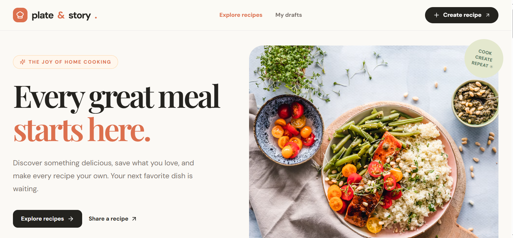
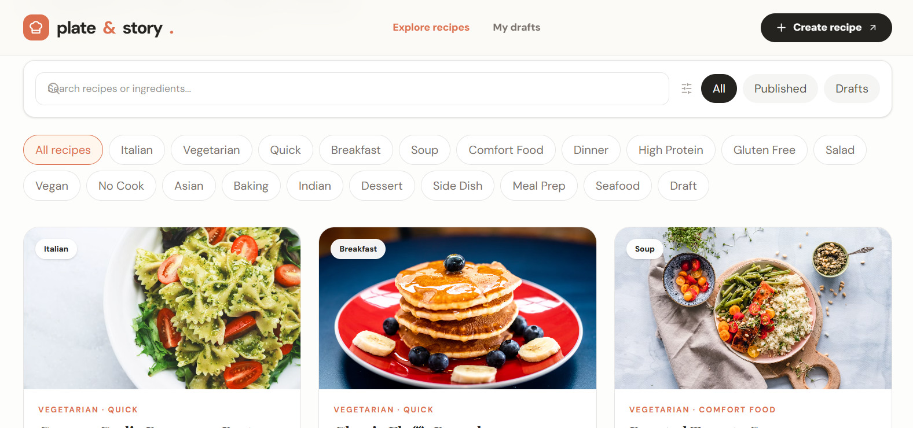

### Recipe details and serving adjustment

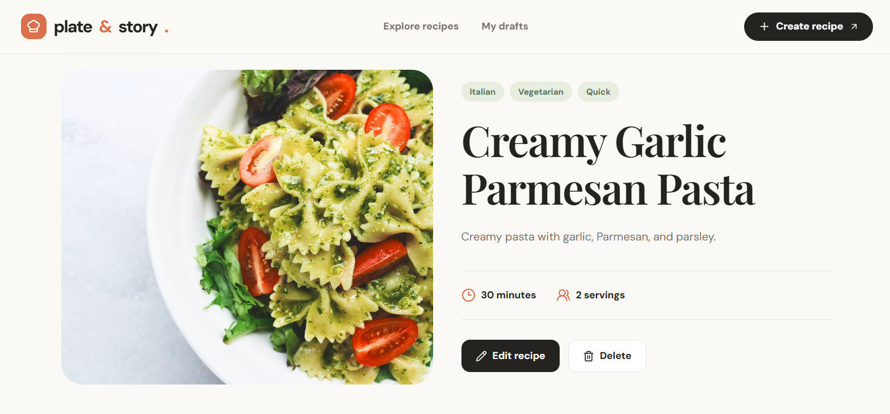
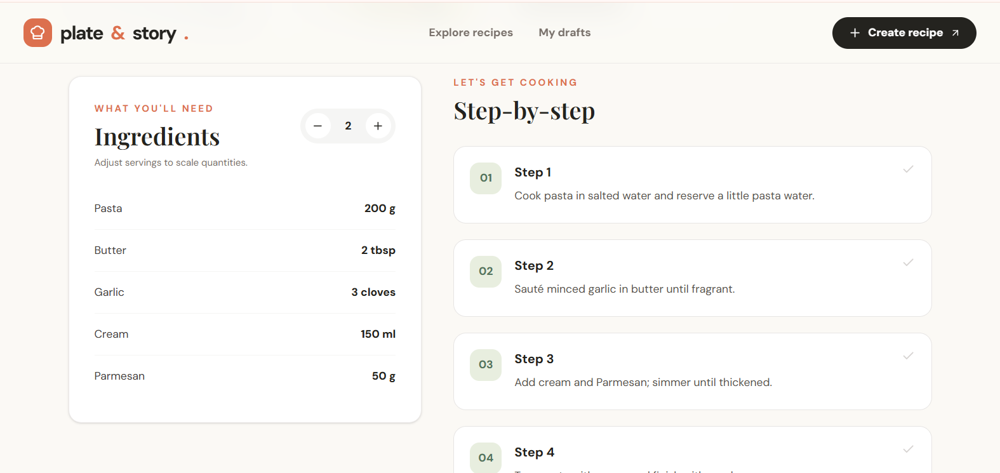

### Create or edit a recipe

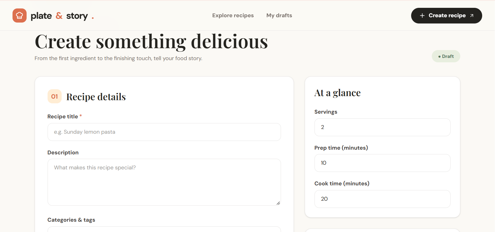
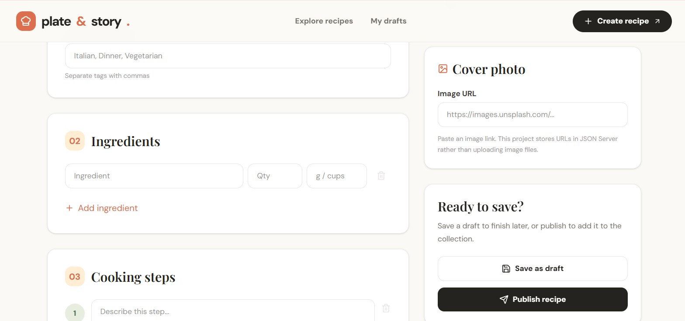

### Mobile layout

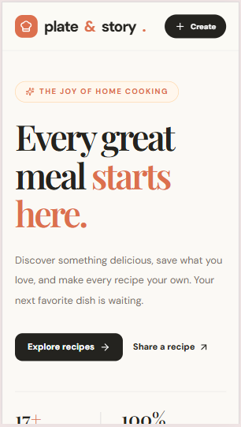
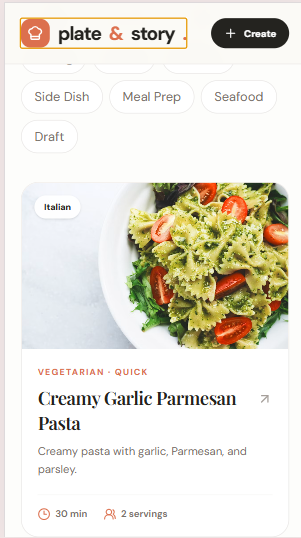
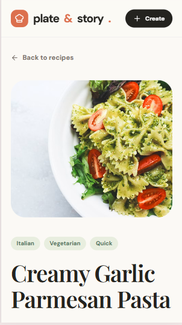
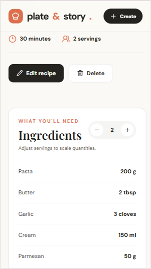
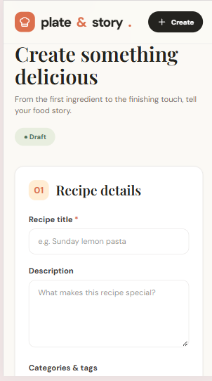


---

## 2. Tech Stack

| Area | Technology | Responsibility |
|---|---|---|
| UI | React 19 + TypeScript | Components, forms, and typed data contracts |
| Styling | Tailwind CSS v4 | Responsive styling and visual consistency |
| Routing | React Router | Pages, URL parameters, and navigation |
| HTTP | Axios | Shared request configuration and transport |
| Mock API | JSON Server | REST endpoints backed by `db.json` |
| Build | Vite | Development and production bundling |
| Testing | Vitest | Unit tests for domain behavior |
| Icons | Lucide React | Icons and visual affordances |

### Local setup

**Prerequisites:** npm and a Node.js version compatible with the installed Vite release (Node 20.19+ or a compatible recent Node 22 release is recommended).

```bash
npm install
```

Optional environment file (`.env` at the project root):

```env
VITE_API_BASE_URL=http://localhost:3001
```

Start the mock API in **Terminal 1**:

```bash
npm run mock:api
```

Start the React development server in **Terminal 2**:

```bash
npm run dev
```

Open the local URL printed by Vite (typically `http://localhost:5173`). To confirm the mock API is available, visit `http://localhost:3001/recipes`.

Additional commands:

```bash
npm run build    # TypeScript check + Vite production build
npm run test     # Run Vitest unit tests
npm run preview  # Preview production build
```

**Note:** Vite exposes `VITE_` variables to the browser. They must not contain secrets. Restart the Vite server after changing `.env`.

---

## 3. Scope and Features

### Implemented

- Recipe library with image cards, text search, tag filtering, and All / Published / Draft views.
- Recipe details with ingredients, ordered cooking steps, preparation/cooking times, and adjustable servings.
- Create and edit flows with dynamically added and removed ingredient/step rows.
- Draft saving, frontend publish checks, and deletion with confirmation.
- Form-level validation messages, request loading/error states, and empty states.
- API operations through a dedicated Axios abstraction rather than direct requests inside presentation components.
- Browser unload and internal route-change protection for unsaved form changes through React Router's blocking APIs.

### Intentionally not included

- Authentication, user accounts, and permission-controlled recipes.
- A custom production backend or database.
- File uploads, image hosting, or image optimization.
- Server-side search, pagination, or caching.
- Ingredient unit conversion or natural-language quantity parsing.

These decisions keep the frontend scope focused on the primary recipe workflows and domain rules.

---

## 4. Domain Model and Data Contracts

The supplied `db.json` is the mock database. Each recipe has a status, preparation/cooking metadata, a list of ingredients, ordered cooking steps, tags, and an optional image URL.

The TypeScript contract in `src/types/recipe.ts` is:

```ts
type RecipeStatus = "draft" | "published";

interface Ingredient {
  id: string;
  name: string;
  quantity: number;
  unit: string;
}

interface RecipeStep {
  id: string;
  order: number;
  instruction: string;
}

interface Recipe {
  id: string;
  title: string;
  description: string;
  servings: number;
  prepTime: number;
  cookTime: number;
  tags: string[];
  status: RecipeStatus;
  ingredients: Ingredient[];
  steps: RecipeStep[];
  image?: string;
}

type RecipePayload = Omit<Recipe, "id">;
```

**Model boundaries:**

- **Recipe** is the persisted entity. Its string `id` identifies the record in JSON Server.
- **RecipePayload** is the create/update payload without a top-level recipe ID.
- **Ingredient** holds a numeric quantity and a display unit. Quantities are stored relative to the recipe's base serving count.
- **RecipeStep** includes an explicit `order` so the display sequence is not dependent on array position.
- **RecipeStatus** distinguishes incomplete drafts from published recipes.
- **image** is a remote URL, not file contents.

The UI, API layer, and data file use the same `prepTime` and `cookTime` property names. No old Gather-format field mapping is required.

---

## 5. Architecture and Separation of Concerns

```text
src/
├── api/
│   ├── constants.ts       # API base URL and endpoint paths
│   ├── apiClient.ts       # Configured Axios client / request wrapper
│   ├── apiMethods.ts      # Reusable GET, POST, PATCH, DELETE functions
│   └── recipeApi.ts       # Recipe-specific REST operations
├── components/
│   ├── Header.tsx
│   ├── Footer.tsx
│   ├── Layout.tsx
│   ├── RecipeCard.tsx
│   ├── RecipeForm.tsx
│   ├── ConfirmDialog.tsx
│   └── State.tsx         # Loading, error, and empty presentations
├── pages/
│   ├── RecipeListPage.tsx
│   ├── RecipeDetailPage.tsx
│   ├── RecipeCreatePage.tsx
│   ├── RecipeEditPage.tsx
│   └── NotFoundPage.tsx
├── types/
│   └── recipe.ts         # Domain types and API payload contract
├── utils/
│   ├── recipe.ts         # Validation, time, and scaling functions
│   └── recipe.test.ts    # Domain unit tests
├── App.tsx
├── AppRouter.tsx
└── index.css             # Tailwind entry and application styles
```

### Request flow

```text
User interaction
    ↓
Page (list, create, detail, edit)
    ↓
Reusable component (RecipeCard / RecipeForm)
    ↓
recipeApi.ts       — domain-specific API functions
    ↓
apiMethods.ts      — reusable HTTP operations
    ↓
apiClient.ts       — Axios base URL, headers, timeout
    ↓
JSON Server        — reads/writes db.json
    ↓
Response → page state → updated UI
```

### Example: publishing a recipe

1. The user chooses **Publish** in the editor, or uses the publish action on a draft's detail page.
2. The application checks the required fields using `validateRecipe()` from `src/utils/recipe.ts`.
3. If validation fails, the UI displays an error without attempting the request.
4. If validation passes, the page calls the relevant recipe service operation.
5. `recipeApi.ts` delegates to `apiMethods.ts`, which calls the shared Axios client.
6. JSON Server stores the updated record and returns the response; the page reflects the result.
7. If the request fails, an error is shown rather than treating it as a successful publish.

**Reasoning:** Presentation is separated from request transport and domain validation. A reviewer can trace a request without reading unrelated component implementation, and the mock backend can later be replaced without redesigning the UI.

---

## 6. Domain Assumptions & Trade-offs

The assignment intentionally leaves some rules unspecified. The following documents the behavior chosen for this implementation.

### Draft vs. published recipes

**Drafts:** A title, positive integer serving count, and valid nonnegative preparation/cooking times are required. Description, ingredients, and instructions can be completed later. A partially entered ingredient must still have a name and a positive quantity.

**Publishing:** Requires all draft checks plus a nonempty description, at least one valid ingredient, and at least one nonempty instruction. These checks are performed by `validateRecipe(recipe, status)`.

**Trade-off:** Validation is enforced in the frontend only. JSON Server will accept a direct HTTP request even if the recipe breaks those rules. A production backend would validate the same contract independently.

### Scaling ingredient quantities

Quantities scale in direct proportion to the selected serving count:

```text
scaledQuantity = originalQuantity × selectedServings / originalServings
```

The current helper rounds the result to **two decimal places**.

| Example | Original | Selected | Result |
|---|---|---|---|
| Pasta | 200 g for 2 servings | 4 servings | 400 g |
| Milk | 250 ml for 4 servings | 2 servings | 125 ml |
| Eggs | 3 eggs for 2 servings | 1 serving | 1.5 eggs |

**Trade-off:** Numeric scaling is simple and predictable but not always kitchen-friendly. Discrete items, such as eggs, are not rounded to whole items; cooking practicality is left to the reader.

### Informal quantities and units

A quantity is modeled as a number and a unit as a string. This supports `200 g`, `2 tbsp`, or `3 cloves`, but **not** expressions such as “a pinch of salt” without extending the domain model. No automatic unit conversion is performed.

### Tags and ordered steps

Tags entered as comma-separated text are trimmed, empty entries removed, and duplicates removed. Blank steps are omitted, and remaining steps are assigned sequential order values. Ingredient and step rows use client-generated IDs.

### Search and filters

Search, tag filtering, and status filtering run in the browser after loading the collection through `GET /recipes`.

**Trade-off:** This is appropriate for the provided 16-recipes dataset. Larger data volumes would benefit from server-side filtering, pagination, and caching.

### Images

The `image` field stores a URL to externally hosted imagery. A broken image may fall back to a placeholder in the UI. Availability of external image hosts is outside this mock app's control.

### Where the domain rules live

The current implementation centralizes validation and scaling behavior in **`src/utils/recipe.ts`**. It does **not yet** move every numerical assumption into a dedicated configuration file: for example, the two-decimal scaling precision is encoded directly in `scaleQuantity()`.

**Recommended next step for the assessment's “no magic numbers” criterion:** Introduce a `src/domain/recipeConfig.ts` containing constants such as `MIN_SERVINGS` and `QUANTITY_DECIMAL_PLACES`, and consume those constants from validation and scaling. This is documented as pending work, not an already implemented feature.

---

## 7. Mock API Documentation

**Base URL:** `http://localhost:3001`, overridden by `VITE_API_BASE_URL` when supplied. JSON request/response bodies use `application/json`.

| Operation | Method | Endpoint | Body | Expected response |
|---|---|---|---|---|
| List recipes | `GET` | `/recipes` | — | Array of `Recipe` |
| Read recipe | `GET` | `/recipes/:id` | — | `Recipe` |
| Create recipe | `POST` | `/recipes` | `RecipePayload` | Created `Recipe` |
| Edit recipe | `PATCH` | `/recipes/:id` | Partial `RecipePayload` | Updated `Recipe` |
| Publish draft | `PATCH` | `/recipes/:id` | `{ "status": "published" }` | Updated `Recipe` |
| Delete recipe | `DELETE` | `/recipes/:id` | — | Successful deletion |

### Create example

```http
POST /recipes
Content-Type: application/json

{
  "title": "Lemon Rice",
  "description": "A quick and fresh rice dish.",
  "servings": 2,
  "prepTime": 10,
  "cookTime": 15,
  "tags": ["Lunch", "Vegetarian"],
  "status": "draft",
  "ingredients": [
    { "id": "ing-1", "name": "Rice", "quantity": 200, "unit": "g" }
  ],
  "steps": [
    { "id": "step-1", "order": 1, "instruction": "Cook the rice." }
  ],
  "image": ""
}
```

A new top-level recipe `id` is assigned by JSON Server and returned in the created record.

### Update example

```http
PATCH /recipes/1
Content-Type: application/json

{ "servings": 4, "prepTime": 15 }
```

### Publish example

```http
PATCH /recipes/16
Content-Type: application/json

{ "status": "published" }
```

### Example curl commands

```bash
curl http://localhost:3001/recipes
curl http://localhost:3001/recipes/1
```

**Mock-contract caveat:** JSON Server supplies CRUD semantics, not business-rule enforcement. Direct API calls can bypass client-side form checks. Network failures, timeouts, and non-success HTTP responses are passed back to page-level error handling.

---

## 8. Application Routes

| Route | Purpose |
|---|---|
| `/` | Redirect to recipe library |
| `/recipes` | List, search, and filter recipes |
| `/recipes?status=draft` | Show drafts |
| `/recipes/new` | Create draft or publish a new recipe |
| `/recipes/:id` | View recipe and adjust servings |
| `/recipes/:id/edit` | Edit existing recipe |
| Other paths | Not-found screen |

Routes are declared in `src/AppRouter.tsx` and share a common layout.

---

## 9. Robustness and Failure Handling

| Situation | Application behavior |
|---|---|
| Initial API request in progress | Show a loading state |
| Empty collection or no filter matches | Show an empty state |
| List or detail API request fails | Show an error message; list view offers retry |
| Invalid servings or negative cooking time | Block save and show validation errors |
| Incomplete ingredient row | Flag the row as invalid before submission |
| Publish without description / ingredient / step | Reject publication in frontend validation |
| Delete action | Ask for confirmation before sending `DELETE` |
| External image unavailable | Use a placeholder where supported |
| Form changed without saving | Use browser unload and React Router navigation protection |
| Request cancelled by navigation | Use `AbortController` for list/detail reads |

The Axios client has a **12-second request timeout**. Requests are not automatically retried; explicit retry is preferable for this small assignment to avoid repeating write operations unexpectedly.

**Known edge case:** `scaleQuantity()` assumes valid, positive original servings. Malformed API records with zero original servings could produce invalid arithmetic. A domain-level guard should be added before relying on untrusted production data.

---

## 10. Tests and Verification

Tests are located in `src/utils/recipe.test.ts` and run with:

```bash
npm run test
```

The current suite defines **three unit tests**:

1. Ingredient quantity scales from `125` at two servings to `250` at four servings.
2. A minimal draft passes validation.
3. An incomplete recipe fails the publication rule for ingredients.

Recommended additional tests:

- Fractional scaling and rounding (including eggs).
- Zero or invalid base serving count.
- Negative/NaN preparation and cooking times.
- Partially completed ingredient rows.
- Publish failures for missing description or instructions.
- API failure and cancellation handling.
- UI integration for create, edit, publish, and delete.

### Manual verification checklist

- [ ] JSON Server returns the 16 seeded records.
- [ ] Recipe cards show text and images.
- [ ] Search, status filters, and tags work.
- [ ] Recipe detail loads, including sorted instructions.
- [ ] Increasing/decreasing servings updates ingredient quantities.
- [ ] Draft can be created and edited.
- [ ] Incomplete recipe cannot be published from the UI.
- [ ] Valid draft can be published.
- [ ] Delete requires confirmation and removes the recipe.
- [ ] API outage shows an error state without crashing the page.
- [ ] `npm run test` passes locally.
- [ ] `npm run build` succeeds locally.

**Verification note:** The items above are a checklist for local review, not a claim that every scenario has already been tested. Add actual test/build results before submitting.

---

## 11. AI Tools Usage & Development Ownership

AI-assisted tools were used extensively to **generate and refine much of the UI implementation**, including component markup, Tailwind CSS styling, responsive layouts, and visual presentation.

**I defined the overall architecture and development approach**, including:

- The decision to separate pages, reusable components, domain utilities, and API infrastructure.
- The Axios-based data-access structure: `apiClient` → reusable HTTP methods → recipe-specific API service.
- Centralized API base URLs and endpoint definitions.
- React Router integration and the boundaries between page-level state and reusable UI components.
- The decision to use the supplied JSON Server database as the mock API contract.
- The overall implementation priorities and how the UI should be connected to real API calls.

AI-assisted output was used as a development aid within this architecture. This disclosure is intended to distinguish **AI-assisted code generation** from the **technical direction and architectural decisions I made**.

Any AI-generated code remains subject to the same review, testing, and maintenance expectations as manually written code.

---

## 12. Limitations and Future Improvements

1. **Centralized rule configuration:** Extract validation thresholds and scaling precision into a dedicated `recipeConfig.ts` module.
2. **Server-side validation:** Enforce publish and data-integrity rules in a real backend rather than relying solely on frontend checks.
3. **Richer ingredient quantities:** Support fractions, approximate measures, discrete ingredients, and optional unit conversion.
4. **Stronger tests:** Add business-rule edge cases, API integration tests, and UI-level tests.
5. **Scalable data access:** Add server-side pagination/filtering and a query cache when the collection grows.
6. **Image management:** Replace external URLs with managed uploads and reliable fallbacks.
7. **Observability:** Add structured logging and more actionable error reporting for production usage.

The priority was to deliver a coherent frontend slice with visible architectural boundaries and explicit trade-offs. These improvements are incremental rather than prerequisites for understanding the current solution.

---

## 13. Submission Notes

- **Track:** Frontend
- **Source code:** https://github.com/ajay-tadi/recipe-builder.git
- **Mock API contract:** `db.json`, JSON Server endpoints documented above
- **Screenshots:** `docs/screenshots/` 
- **Setup:** `npm install`, `npm run mock:api`, `npm run dev`
- **Checks:** `npm run test`, `npm run build`

The README documents the system's current behavior and limitations so reviewers can evaluate the decisions without having to infer them from every source file.
